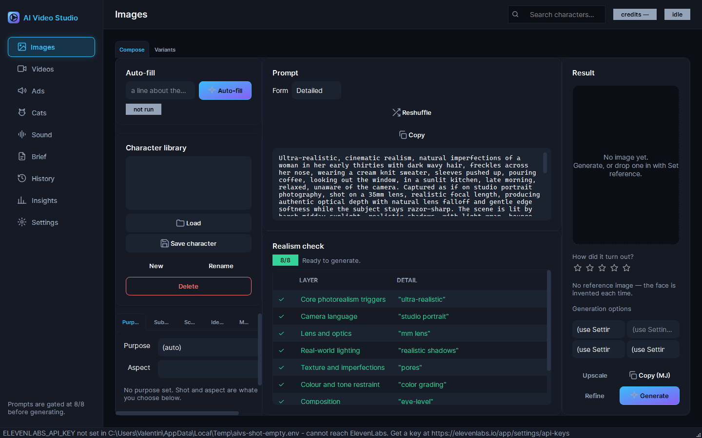
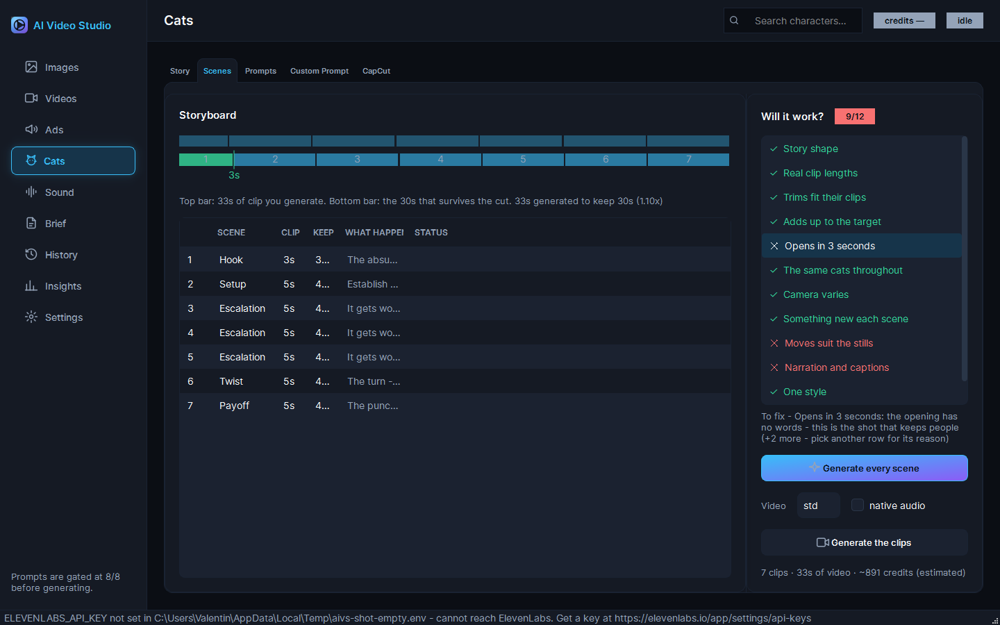
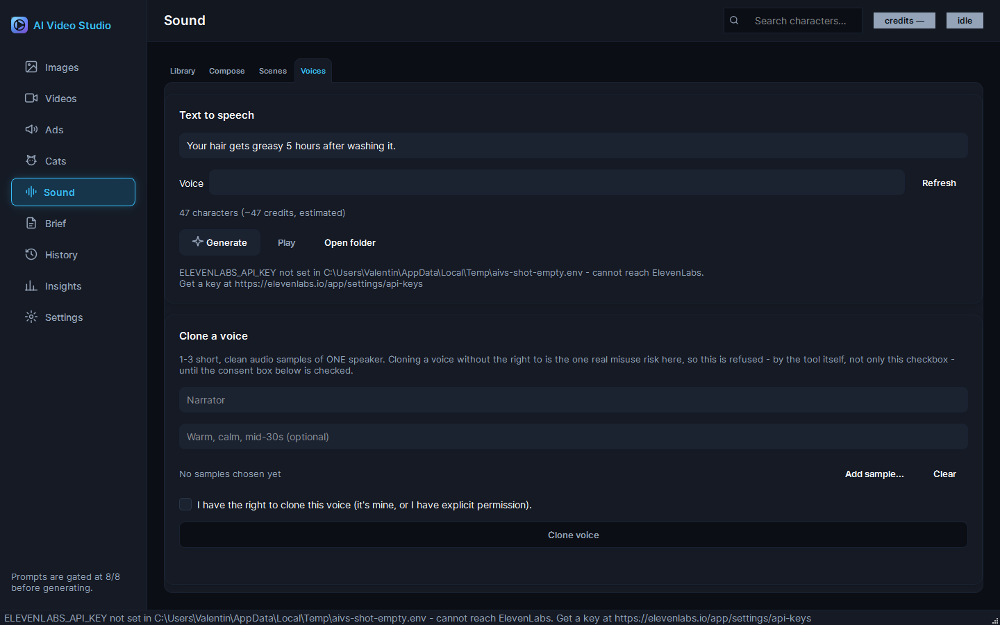

# AI Video Studio

An AI video and avatar production workspace with a PyQt6 desktop front end — built on the
method from an AI video production course, turned into something executable: repeatable
procedures and small, deterministic tools, so producing a convincing avatar, ad, or short-form
video is a command (or a click), not a memory exercise.



## What it does

- **Compose an avatar** from a structured character spec (subject, wardrobe, setting, action,
  mood, shot, lighting, composition), scored live against an 8-layer realism checklist before
  you spend a generation.
- **Generate the image** through Nano Banana Pro (via Kie) or Higgsfield Soul, with reference-
  image identity lock so the same character survives across shots.
- **Turn a still into a Kling 3.0 clip** — a 40-move camera-movement toolkit with compatibility
  checks against your still, cost estimates before you commit, and real clip generation.
- **Write a five-beat UGC advert** (pain → relatable → shift → solution → proof), one presenter
  locked across every beat, gated by an ad-quality checklist modeled on a real worked example.
- **Tell a cat story in scenes** — an idea becomes a full storyboard (or a scripted one you
  write yourself), each scene a still + a camera move, plus a CapCut edit sheet to assemble it.
  A **Custom Prompt** tab goes the other direction: paste a prompt you already wrote, split it
  into Subject / Background / Style & Atmosphere, and adapt it by conversation or reference
  image until it's ready.
- **Sound-design each scene** with three ElevenLabs effect layers (ambience, key effect,
  accent), scored against rules measured off 100 real examples — and, with a real ElevenLabs
  key, generate the actual sound effects, text-to-speech and cloned voices, not just the
  prompts. Ads' per-beat copy and Cats' scenes can be voiced the same way.
- **A text-model co-pilot** (OpenRouter, optional) drafts and rewrites — but never has the last
  word: every reply is re-scored by the same linter a human-written prompt has to pass.
- **History and Insights** — every generation is logged with its prompt, its score, and (once
  you rate it) its outcome, so the vocabulary the app suggests gets calibrated to what actually
  worked for you, not just what a checklist allows.





## Why it's built this way

The project is organised around three parts, plus a GUI that is deliberately *not* a fourth:

- **Workflows** (`/workflows/`) — step-by-step procedures, one Markdown file per job. They name
  the tool each step calls and the quality gate it has to pass.
- **Tools** (`/tools/`) — the logic. Standard-library Python, each one runs from the command
  line and is deterministic. `python tools/<name>.py --help` documents itself.
- **The Agent** — an LLM that reads a workflow, calls the named tools in order, and never
  reimplements their logic inline.
- **The GUI** (`gui.py` + `ui/`) is a front end *over* the same tools and workflows — it composes
  prompts, scores them, and generates through the exact functions the CLI uses. If the GUI and
  the CLI could ever disagree about what a good prompt is, that would be a bug, not a feature.

The core discipline that makes this more than a prompt builder: **a text model suggests, a
linter decides.** Nothing a model writes reaches a prompt or a spec unvalidated — every
AI-assisted feature whitelists what a reply is allowed to set and re-scores the result before
it's accepted. Ratings feed a weighting system that biases future vocabulary toward what
actually rated well, so the app gets better calibrated to your own results over time.

## Getting started

```bash
git clone https://github.com/valu-03/ai-video-studio.git
cd ai-video-studio
pip install -r requirements.txt
cp .env.example .env   # fill in the keys you have — every key is optional
python gui.py
```

Nothing requires a key to explore. `KIE_API_KEY` (or `HIGGSFIELD_API_KEY_ID` +
`HIGGSFIELD_API_KEY_SECRET`) is needed to actually generate an image; the same Kie key also
unlocks Kling 3.0 clips. `OPENROUTER_API_KEY` is needed only for the text-model helpers (Brief,
auto-fill, the Custom Prompt tab's Analyze/Refine) — everything else works without it.

Every tool also runs standalone from the command line, e.g.:

```bash
python tools/build_prompt.py --help
python tools/brief.py idea "a tired barista closing up late"
python tools/realism_lint.py temp/outputs/prompts/some-prompt.txt
```

## Tests

```bash
python tests/run_all.py
```

One command runs every suite — no test framework, no dependencies beyond PyQt6, Qt runs
offscreen so nothing pops up a window.

## Building a Windows .exe

```bash
pip install pyinstaller        # build-only — not in requirements.txt
pyinstaller AIVideoStudio.spec
```

The result is `dist/AI Video Studio/AI Video Studio.exe` — a folder build, not a single file,
and deliberately so: `AIVideoStudio.spec` lays everything out flat beside the exe, mirroring this
repo's own layout exactly (`tools/`, `assets/`, and — once you create them — `.env` and `temp/`
all sit right next to it). That is what lets your character library, generation history and API
keys survive between launches; a one-file build re-extracts to a fresh temp folder every time it
runs, which would quietly throw all of that away on every close.

First launch: copy `.env.example` (already sitting next to the built exe) to `.env` and fill in
your keys, exactly like the `Getting started` step above — just in the built folder instead of
the repo. Everything else — the character library, `temp/outputs/`, ratings — builds up next to
the exe from there, the same way it does when running `python gui.py` from the repo.

## Project layout

```
ai-video-studio/
  gui.py               desktop front end — python gui.py
  ui/                   PyQt6 UI layer (tokens, theme, widgets, workers, views)
  tools/                the logic — one deterministic script per job
  workflows/             step-by-step procedures the agent follows
  tests/                 every suite; tests/run_all.py runs them all
  assets/icons/          generated SVG icon set
  temp/                  runtime data — gitignored (outputs are regenerable,
                         resources are yours and never committed)
```

See `CLAUDE.md` for the full internal map and the house rules this project holds itself to.

## Status

Phase 2 — avatars through to real video and audio all ship: realistic avatars, a locked
character across shots, real Kling 3.0 clips (not just prompts), five-beat UGC ads, a cat
story with its CapCut sheet, and three-layer sound design per scene.
